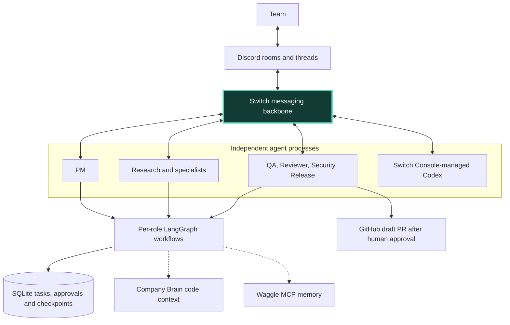
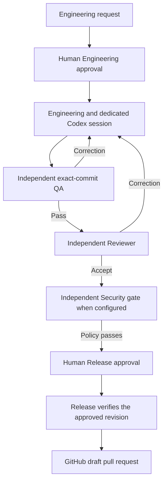

# Flip — Your team. Your agents. One conversation.

**Discord is the interface. Switch is the backbone. AI agents are your teammates.**

Flip brings AI work into the conversation your team already uses. A teammate describes a problem in Discord, the PM coordinates independent specialists through Switch, and findings, progress, approval requests, and delivery receipts return to the same thread. Humans control Engineering and Release decisions.

[](https://github.com/Abhigyan-Shekhar/flip/actions/workflows/checks.yml)
[](pyproject.toml)
[](src/switchcrew/graphs.py)

[Public incident report](https://flip-green-check-report-2026.dualheron.chatgpt.site/) · [Real fix — PR #11](https://github.com/Abhigyan-Shekhar/flip/pull/11) · [Demo evidence](#the-demo-the-green-check-that-lied) · [Run locally](#run-flip)

## Why bring agents into Discord?

An isolated coding session leaves someone carrying context between the agent and the team. Flip puts that coordination in the shared conversation. Research can return evidence, Engineering can implement an approved change, and independent agents can check the resulting commit before a human authorizes delivery.

**Switch makes this a team workflow.** Each worker has its own authenticated identity and connection. PM sends addressed handoffs through Switch, recipients acknowledge assignments, and results travel back through Switch. LangGraph runs a role's local workflow. Flip's SQLite store records the task, assignment, approvals, and delivery state across process restarts.



| Technology | Responsibility |
| --- | --- |
| Discord | Human collaboration, requests, progress, and scoped decisions |
| **Switch** | Central transport, independent agent identities, addressed messages, and cross-agent communication |
| LangGraph | Each agent's reasoning and workflow execution |
| Codex | Optional CLI reasoning and separately authorized Engineering execution |
| SQLite | Durable tasks, plans, inbox/outbox, events, approvals, execution records, and graph checkpoints |
| Company Brain | Revision-grounded repository relationships and source evidence |
| Waggle MCP | Project-scoped recall of curated outcomes and earlier decisions |
| GitHub | Version control, pull requests, checks, and approved delivery |

### One request, six steps

1. A human submits a request in an authorized Discord room or thread.
2. Switch delivers it to PM, which validates identity, scope, and requirements.
3. PM persists a plan and delegates to separately registered specialists through Switch.
4. Recipients acknowledge their assignments, run their configured workflows, and return evidence.
5. Human approvals and independent verification gate sensitive execution and publication.
6. Switch carries progress, results, and receipts back to the original conversation.

The durable plan survives worker restarts. Transport delivery and application acceptance are separate facts, and uncertain external actions require reconciliation.

## Choose the right branch

This guide targets **`master`**, whose application baseline is [`5bd88bd`](https://github.com/Abhigyan-Shekhar/flip/commit/5bd88bdc803cc5d30d361923b3dfce62e93bfe65). The [hackathon demo branch](https://github.com/Abhigyan-Shekhar/flip/tree/codex/flip-hackathon-demo-20261107) contains newer integrations and evidence.

| Capability | `master` | Demo branch additions |
| --- | --- | --- |
| Agent workflows | 17-role registry, per-role graphs, optional CLI harness, durable orchestration | Later integration fixes and acceptance records |
| Discord intake | Structured requests, scoped `/crew` text controls, opt-in natural incident intake | Prose requests with explicit success criteria, readable approvals, expanded controls |
| Codex Engineering | Pinned local Console control adapter | Isolated managed-controller-v2 adapter and provisioning contract |
| Security | Configured scanners, normalized finding validation, revision-bound policy | Native Trivy/Semgrep/pip-audit adapters and the incomplete-native-report fix |
| Delivery | Human-approved draft PR publication | Optional guarded merge and signed `/flip` approval/merge controls |

Demo-only documents below link explicitly to that branch. Checking out `master` does not install those extensions.

## A workforce of 17 agents

These are the roles registered in [`agents.py`](src/switchcrew/agents.py). Deployment requires a separate registration, private configuration, and an appropriate executor for each worker. A registered role alone does not establish a live agent.

| Team | Agent | Purpose |
| --- | --- | --- |
| Coordination and Research | **PM** | Validate requests, plan dependent work, dispatch handoffs, and track outcomes |
| Coordination and Research | **Research** | Retrieve bounded source excerpts and optional repository context |
| Engineering and Verification | **Engineering** | Deliver approved assignments to a dedicated Console-managed Codex session |
| Engineering and Verification | **QA** | Run operator-configured checks against the exact committed revision |
| Engineering and Verification | **Reviewer** | Independently examine the diff and configured review checks |
| Engineering and Verification | **Security** | Analyze configured snapshots or execute configured revision-bound scanners |
| Engineering and Verification | **Release** | Verify authorization and evidence, then publish the approved commit as a draft PR |
| Knowledge and Operations | **Documentation** | Produce cited documentation drafts and acceptance checklists |
| Knowledge and Operations | **Knowledge** | Curate deduplicated, provenance-linked knowledge entries |
| Knowledge and Operations | **Onboarding** | Build source-backed setup and orientation checklists |
| Knowledge and Operations | **Community** | Triage support questions and draft cited responses |
| Knowledge and Operations | **Moderation** | Queue rule-matched messages for human review |
| Knowledge and Operations | **Scheduling** | Find conflicts in supplied timezone-aware calendar snapshots |
| Knowledge and Operations | **Analytics** | Summarize configured metric records and sampled durations |
| Knowledge and Operations | **Incident** | Build event timelines and suggest investigation steps |
| Voice and Meetings | **Voice** | Process consented WAV recordings and generate configured speech replies |
| Voice and Meetings | **Notes** | Produce evidence-linked meeting notes and action proposals |

Snapshot-based specialists produce bounded analyses and drafts. Moderation does not ban users, Scheduling does not write calendars, and Incident does not restart production services. Voice file processing and Notes are implemented; live Discord voice/DAVE capture remains unverified. See [workflows](docs/AGENT_WORKFLOWS.md), [specialist contracts](docs/SPECIALISTS.md), and [organization status](docs/ORGANIZATION_IMPLEMENTATION.md).

## What the team can do

### Coordinate independent work

PM creates durable tasks and dependent plans, dispatches to configured specialists, and tracks acknowledgments and completion. Default orchestration uses bounded criterion-based routing. An opt-in CLI harness can generate validated plans, with role constraints and invocation budgets. Model-generated results require human review before their dependent work advances. [Orchestration](docs/ORCHESTRATION.md) · [Planning budgets](docs/PLANNING_BUDGETS.md)

Discord controls expose task status, team selection, audit replay, and scoped cancellation. The read-only Control Room shows plans, approvals, recent activity, and failures. Signed slash inspection requires separate Discord registration, public HTTPS hosting, and verified thread mappings. On `master`, its native `/crew` commands are read-only. [Text commands](docs/CREW_COMMANDS.md) · [Operator dashboard](docs/OPERATOR_DASHBOARD.md)

### Engineer, check, correct, deliver



Each corrected revision needs fresh QA and review. Corrections retain the approved scope and have a bounded retry budget. A model response, remembered lesson, or generic task-state transition cannot authorize Engineering or Release. Credentials for human approvals and GitHub publication are separate from worker credentials. [Approval and Release](docs/APPROVAL_RELEASE.md) · [Correction loops](docs/REVIEW_CORRECTIONS.md)

On the demo branch, [guarded merging](https://github.com/Abhigyan-Shekhar/flip/blob/codex/flip-hackathon-demo-20261107/docs/GUARDED_MERGE.md) adds a separate human merge decision, exact-head verification, required GitHub checks, and an independent Security gate. This extension is outside `master`'s draft-PR lifecycle.

### Use Codex in two distinct ways

- **Model harness.** Locally authenticated Codex CLI reasoning can power PM, Research, and supported nonprivileged specialists. Outputs enter the existing LangGraph, Switch, and SQLite workflow as reviewable drafts.
- **Engineering worker.** A separately provisioned Switch Console-managed Codex agent receives an authorized assignment in its dedicated checkout, implements it, commits the result, and returns a receipt. QA, Reviewer, and Release execute independently. CLI reasoning access does not grant Engineering authority.

`master` uses the pinned local Console adapter. The demo branch's [managed-controller provisioning contract](https://github.com/Abhigyan-Shekhar/flip/blob/codex/flip-hackathon-demo-20261107/deploy/console-controller/README.md) describes its isolated controller path. Both need operator-selected workspaces, authenticated providers, and independently enforced host permissions. [Harness runtime](docs/HARNESS_RUNTIME.md) · [Engineering integration](docs/ENGINEERING_QA.md) · [Isolation](docs/ENGINEERING_ISOLATION.md)

### Add code understanding and shared memory

| Integration | What it contributes | Trust boundary |
| --- | --- | --- |
| **Company Brain** | Repository relationships, change-impact context, source anchors, indexed revision, and coverage warnings | Read-only evidence must match the registered checkout and exact Git revision. Dirty, stale, missing, or mismatched indexes yield warnings. |
| **Waggle MCP** | Shared project recall, previous decisions, and curated role/task observations | Historical context remains guidance. It cannot approve execution or replace current source and verification. |

Company Brain describes code. Waggle retains selected project history. Private personal/team/organization knowledge uses Flip's local access controls; only approved project lessons can be projected to shared memory. [Company Brain](docs/COMPANY_BRAIN.md) · [Memory](docs/MEMORY.md) · [Knowledge and learning](docs/KNOWLEDGE_LEARNING.md)

Organization modules also provide consent tracking, Voice → Notes handoffs, human-confirmed action proposals, employee Codex bindings, authorized OSS intake, Git change reports, and an independent watchdog. They require their documented policies and services. [Organization setup](docs/ORGANIZATION_SETUP.md) · [Recorded meetings](docs/MEETINGS.md) · [Employee agents](docs/EMPLOYEE_AGENTS.md)

### Apply configured Security policy

Security findings and receipts bind to an exact revision, configured commands, exit status, and severity policy. Missing scanners, invalid normalized output, timeouts, or insufficient evidence produce blocked/failed results. Scanner installation, vulnerability databases, allowed roots, and severity thresholds are operator responsibilities.

**The native-report fix demonstrated in PR #11 is on the demo branch.** `master` still has the older common-array parser. Configure `master` scanners to emit the documented normalized contract; use the demo branch's fixed adapters for native Trivy, Semgrep, and pip-audit reports. Those adapters validate report envelopes, fail on incomplete/invalid output, and preserve unknown severity where the source supplies none. A clean scan never establishes the absence of vulnerabilities. [Scanner adapters and limits](https://github.com/Abhigyan-Shekhar/flip/blob/codex/flip-hackathon-demo-20261107/docs/SECURITY_SCANNERS.md) · [Scanner contract](docs/TRIGGERED_CHECKS.md) · [Security policy](docs/ORGANIZATION_SETUP.md)

## Run Flip

### 1. Install the application

Prerequisites are **Python 3.12**, [uv](https://docs.astral.sh/uv/getting-started/installation/), Git, Docker with Compose v2 and a working daemon, and compatible Switch server/Console versions. Discord setup needs an operator-owned application/bot. Codex CLI, Company Brain, and Waggle are optional integrations.

```bash
git clone https://github.com/Abhigyan-Shekhar/flip.git
cd flip
uv sync --frozen --no-editable
test -e .env || cp .env.example .env
chmod 600 .env
uv run --no-sync python -c 'import secrets; print(secrets.token_urlsafe(32))'
```

Put the generated token in `SWITCHCREW_API_TOKEN` in `.env`. Supply independent human approval credentials only to the API process, and the GitHub credential only to Release's private configuration. The noneditable install also avoids the documented macOS editable-import issue. Review [.env.example](.env.example) before enabling integrations. Keep registrations, provider authentication, private JSON, and SQLite files out of Git.

### 2. Start Switch and connect Discord

```bash
docker info
bash deploy/switch/local.sh up
bash deploy/switch/local.sh ps
curl --fail http://127.0.0.1:8080/health/ready
```

The first run builds the official stack pinned to `557b62b23002548baa678339a97c8140c1ccaa8b`; later starts preserve credentials and PostgreSQL data. In **Switch Console v0.40.1**, choose **Connect to an existing server** with gateway `http://127.0.0.1:3001` and API `http://127.0.0.1:8080`. Use the locally generated admin credentials from protected `.switch/server/.env`.

In Console, connect the built-in **Discord text bridge** under server Home → Messaging apps. Configure a dedicated bot and guild, enable Server Members and Message Content intents, and invite it with `bot` and `applications.commands` scopes. Required permissions include channel/history access, sending messages and thread replies, webhooks, channels, roles, and attachments. Restrict channel visibility, link the human account, and post a channel message to create the bridged room.

Follow the [pinned deployment and Discord provisioning guide](deploy/switch/README.md) for the compatible Console download, exact permissions, room roles, addressing policies, and identity verification. DMs are outside this text-bridge setup.

### 3. Register PM and Research

Privately set `SWITCH_REGISTRATION_TOKEN` from the pinned Switch deployment's `AGENT_REGISTRATION_TOKEN`, then register each identity once.

```bash
mkdir -p .switch
chmod 700 .switch
uv run --no-sync python scripts/register_agents.py --url http://127.0.0.1:8080 \
  --name pm-agent --display-name 'PM Agent' \
  --description 'Coordinates team tasks' --output .switch/pm.json
uv run --no-sync python scripts/register_agents.py --url http://127.0.0.1:8080 \
  --name research-agent --display-name 'Research Agent' \
  --description 'Retrieves configured public evidence' --output .switch/research.json
unset SWITCH_REGISTRATION_TOKEN
```

The script writes one-time credentials privately and refuses to overwrite a registration file. Invite both agents to the room, define their `pm`/`research` room roles, and permit the intended human and peer senders in Switch's addressing policies.

Populate these `.env` settings from operator-verified records:

| Settings | Meaning |
| --- | --- |
| `SWITCHCREW_SWITCH_BASE_URL`, `SWITCHCREW_SWITCH_ROOM_ID` | Agent bridge URL and bridged room |
| `SWITCHCREW_PM_AGENT_ID`, `SWITCHCREW_RESEARCH_AGENT_ID` | Registration IDs returned by the script |
| `SWITCHCREW_PM_API_KEY`, `SWITCHCREW_RESEARCH_API_KEY` | Separate private worker keys |
| `SWITCHCREW_PM_PARTICIPANT_ID`, `SWITCHCREW_RESEARCH_PARTICIPANT_ID` | Verified authenticated transport sender IDs |
| `SWITCHCREW_PM_NAME`, `SWITCHCREW_RESEARCH_NAME` | Exact targeted names, `pm-agent` and `research-agent` |
| `SWITCHCREW_DISCORD_GUILD_IDS`, `SWITCHCREW_DISCORD_USER_IDS`, `SWITCHCREW_DISCORD_BINDINGS` | Nonempty allowlists and verified room/bridge/channel/user bindings |
| `SWITCHCREW_RESEARCH_SOURCE_URLS` | Public HTTPS sources Research may retrieve |

**Registration IDs, room membership record IDs, and transport sender IDs can differ.** Verify sender IDs against authenticated room history and client mappings. Target names route messages; display names and message JSON never authenticate a caller. [Identity provisioning details](deploy/switch/README.md#live-provisioning-corrections)

### 4. Run the API and workers

Run each process in a separate terminal from the checkout, sharing the same local application database and configured checkpoint database.

```bash
uv run --no-sync uvicorn switchcrew.api:create_app --factory \
  --host 127.0.0.1 --port 8000 --no-access-log
```

```bash
uv run --no-sync python -m switchcrew.workers research
```

```bash
uv run --no-sync python -m switchcrew.workers pm
```

`GET http://127.0.0.1:8000/health` is public. Open the [Control Room](http://127.0.0.1:8000/dashboard) and connect with the private service bearer token. Task and operator APIs require authentication; approvals use separate human credentials. The dashboard is read-only. [API operations](docs/OPERATIONS.md) · [Dashboard and slash setup](docs/OPERATOR_DASHBOARD.md)

Provision additional roles with their own mode-0600 registry and capability files. For example, after configuring a Documentation executor and its permitted PM peer:

```bash
uv run --no-sync python -m switchcrew.runtime documentation \
  --registry "$HOME/.config/flip/documentation-registry.json" \
  --capability-config "$HOME/.config/flip/documentation-capability.json" \
  --database data/switchcrew.sqlite3 --url http://127.0.0.1:8080
```

The [runtime contract](docs/AGENT_SWITCH.md) defines the registry's `agent_id`, `participant_id`, `api_key`, `room_id`, `allowed_senders`, and `target_names`. [Orchestration setup](docs/ORCHESTRATION.md) supplies a valid Documentation capability example. With `--capability-config`, pass required settings there explicitly because the generic runtime skips the root `.env`. Engineering/QA/Reviewer/Release use the separate [privileged worker setup](docs/APPROVAL_RELEASE.md).

For container deployment, see [Compose configuration](compose.yaml) and the [local network/recovery guide](deploy/switch/README.md). The API/PM/Research Compose services are a starting point; additional specialists need individual provisioning.

### 5. Ask the team to work

On `master`, send structured requests in an authorized, bridged Discord thread. The objective and acceptance criteria are ordinary English inside a validated envelope.

**Research a bounded question** after setting `SWITCHCREW_RESEARCH_SOURCE_URLS=["https://docs.discord.com/developers/events/gateway.md"]` in `.env`:

```json
{"question":"What are Discord Gateway intents?","acceptance_criteria":["Find official source excerpts explaining intents"]}
```

**Ask PM to coordinate configured specialists**:

```json
{"kind":"orchestrate","question":"Prepare a source-backed reconnect guide","acceptance_criteria":["Find reconnect evidence from configured official sources","Write documentation covering reconnect behavior"]}
```

**Request Engineering work** after provisioning independent workers, an operator-owned `fix-answer` job template, approvers, and the publication destination:

```json
{"kind":"engineering","job_key":"fix-answer","question":"Correct answer.txt in the approved demo repository","acceptance_criteria":["The file contains exactly correct followed by a newline"]}
```

This creates an approval request. An authorized human must inspect the task/version and submit the actual decision through the [approval flow](docs/APPROVAL_RELEASE.md). Use `/crew status TASK_ID`, `/crew team TASK_ID`, `/crew why TASK_ID`, `/crew replay TASK_ID`, or `/crew cancel TASK_ID` as text commands in that task's original thread. These messages are distinct from registered native slash commands.

The demo branch also accepts prose such as `Please fix answer.txt.` followed by `Success criteria:` and explicit bullet points. Its exact approval phrases include task ID, stage, and version. See [natural-language controls](https://github.com/Abhigyan-Shekhar/flip/blob/codex/flip-hackathon-demo-20261107/docs/NATURAL_LANGUAGE_2026-11-05.md). Arbitrary prose is not a universal request parser on `master`.

### 6. Connect optional reasoning and context

**Codex model harness.** Install the official CLI, run `codex login` as the OS user running the workers, and check `codex --version`. Create a private harness JSON file outside the repository, replacing the workspace below with an existing, isolated operator-owned directory:

```json
{
  "roles": {
    "pm": {"provider": "codex", "workspace": "/absolute/operator-owned/workspace", "timeout_seconds": 180},
    "research": {"provider": "codex", "workspace": "/absolute/operator-owned/workspace", "timeout_seconds": 180}
  }
}
```

Set `SWITCHCREW_HARNESS_CONFIG` to its absolute path and `chmod 600` the file. The adapter invokes the signed-in CLI in a temporary working directory; OS permissions still govern accessible files. Provider quotas apply. Containers need their own deliberately provisioned CLI/auth environment. For approved Engineering tasks, provision the dedicated Console agent and checkout separately. [Harness configuration](docs/HARNESS_RUNTIME.md) · [Console Engineering](docs/ENGINEERING_QA.md)

**Company Brain.** After indexing and registering the intended checkout, start the private environment configuration with:

```dotenv
SWITCHCREW_COMPANY_BRAIN_ENABLED=true
```

Set `SWITCHCREW_COMPANY_BRAIN_REPO_ROOT` to the absolute indexed checkout and `SWITCHCREW_COMPANY_BRAIN_REVISION` to its exact full Git SHA. Choose `SWITCHCREW_COMPANY_BRAIN_COMMAND` as a JSON argv array for your installed wrapper, or `SWITCHCREW_COMPANY_BRAIN_URL` for your existing HTTPS MCP endpoint. [Full setup and read-only probe](docs/COMPANY_BRAIN.md)

**Waggle.** Minimal environment settings are:

```dotenv
SWITCHCREW_MEMORY_ENABLED=true
SWITCHCREW_MEMORY_PROJECT=github.com/Abhigyan-Shekhar/flip
```

Choose `SWITCHCREW_WAGGLE_COMMAND` for your installed stdio server, or `SWITCHCREW_WAGGLE_URL` for an existing HTTPS MCP service. Configure its persistence and access separately. These settings enable recall and curated observations; they do not grant execution permissions. [Transport examples and acceptance](docs/MEMORY.md)

### 7. Validate the checkout

These are the repository's CI checks:

```bash
uv run --no-sync pytest -q
uv run --no-sync ruff check .
uv run --no-sync ruff format --check src tests scripts
uv build
```

The `master` application baseline `5bd88bd` was rechecked locally on November 7, 2026 with **556 passed, 3 skipped**. The three skipped tests require opt-in live configuration. Automated checks validate code behavior; live deployment evidence is recorded separately. Use the [deployment acceptance runbook](docs/DEPLOYMENT_ACCEPTANCE.md) before relying on a configured host.

## The Demo: The Green Check That Lied

A green Security result should mean the report was complete enough to evaluate. The demonstrated native Trivy bug allowed incomplete output to be interpreted as clean. The team reproduced it against an exact revision, investigated the parser, committed a correction, and recorded independent checks and human-controlled delivery.

| Recorded run | What the evidence establishes |
| --- | --- |
| **November 4 · default-branch deployment checkpoint** | Real Discord PM → Research, original-thread reply, restart persistence, temporary signed status lookup, and isolated verification components. [Checkpoint](docs/VERIFICATION_2026-11-04.md) |
| **November 5 · separate disposable-repository acceptance** | Human Engineering request and approval in Discord, real Switch handoffs, managed Codex execution, an intentionally failing revision rejected by QA, a correction, fresh QA/Reviewer/Security evidence, and human Release approval producing a real draft [PR #1](https://github.com/Abhigyan-Shekhar/flip-acceptance-20261104/pull/1). The run included integration changes beyond `master`. [Run and evidence](https://github.com/Abhigyan-Shekhar/flip/blob/codex/flip-hackathon-demo-20261107/docs/LIVE_PIPELINE_2026-11-05.md) |
| **November 6 · scanner fix and delivery** | [PR #11](https://github.com/Abhigyan-Shekhar/flip/pull/11) contains the native-report fix and formatting correction. It merged into **`codex/demo-green-check-20261106`** at [`37d1253`](https://github.com/Abhigyan-Shekhar/flip/commit/37d125330ddd0dc603da92a442e796cd2542d683). Its merged status does not place the fix on `master`. |
| **Published explanation** | The [public incident report](https://flip-green-check-report-2026.dualheron.chatgpt.site/) explains the issue and links to the fix. It was published separately with **Codex Sites**. Flip is not the site's hosting service. |

The [demo evidence package](https://github.com/Abhigyan-Shekhar/flip/tree/codex/flip-hackathon-demo-20261107/demo-production) preserves sources and verification boundaries. These are dated runs with separate receipts, rather than a single continuous live trace. Core development began before the event; November 4–7 work covers deployment, integration repair, acceptance, and demonstration. [Build history](docs/HACKATHON_BUILD_LOG.md)

## Engineering boundaries that matter

- **Human authority.** Independently authenticated, versioned approvals gate Engineering and Release. A peer message, model output, or source document cannot approve an action.
- **Independent verification.** QA and Reviewer validate the exact committed SHA. Configured Security policy ties findings and severity decisions to that revision. New commits invalidate old evidence.
- **Execution containment.** Configured QA/Review/Security runners use digest-pinned images, bounded resources, restricted mounts, and denied networking. Console-managed Engineering also needs its own least-privilege host/OS boundary. [Isolation contract](docs/ENGINEERING_ISOLATION.md)
- **Durable recovery.** SQLite transactions persist tasks, events, inbox/outbox, and handoff IDs. Separate graph checkpoints and execution records support restart/replay. Deduplication suppresses repeated completed work; an uncertain external send or action still needs reconciliation.
- **Credential separation.** Role keys, provider login state, human approval credentials, and Release's GitHub credential have distinct owners. Sender validation and original-thread scoping remain active through handoffs.

## Find your way around

```text
src/switchcrew/
  agents.py, graphs.py          Role registry and independent LangGraphs
  switch.py, runtime.py        Switch transport and specialist processes
  workers.py, orchestration.py PM/Research intake and dependency planning
  engineering.py, qa.py        Console Codex execution and exact-SHA checks
  reviewer.py, release.py      Independent review and approved draft PR delivery
  security.py, security_gate.py Configured scanners and revision-bound policy
  store.py, approval.py        Durable tasks, events, handoffs, and human decisions
  company_brain.py, memory.py  Repository context and project memory
  voice.py, notes.py           Consented recordings and evidence-linked notes
  organization*.py             Organization services and private policy wiring
  api.py, operator_dashboard.py FastAPI endpoints and Control Room
scripts/register_agents.py     One-time independent worker registration
deploy/switch/                 Pinned Switch deployment and recovery scripts
tests/                        Automated contracts and opt-in live checks
docs/                         Setup, contracts, status, and acceptance evidence
research/voice/               Live voice transport investigation
.github/workflows/checks.yml   Lint, format, tests, and package build
```

Start with [Operations](docs/OPERATIONS.md), [Switch setup](deploy/switch/README.md), [Agent runtimes](docs/AGENT_SWITCH.md), and [Organization setup](docs/ORGANIZATION_SETUP.md), [Mac runtime](docs/LOCAL_MAC_RUNTIME.md), and [implementation status](docs/IMPLEMENTATION_STATUS.md). For rollout evidence, use [Deployment acceptance](docs/DEPLOYMENT_ACCEPTANCE.md), [Recorded-meeting acceptance](docs/RECORDED_MEETING_ACCEPTANCE.md), and [Memory/graph acceptance](docs/COMBINED_MEMORY_ACCEPTANCE.md).

Live voice/DAVE reception, persistent custom slash hosting, and a fully deployed 17-agent organization remain outside the verified baseline. A registered identity, configured dashboard entry, or passing local test does not establish that integration is live.

**Flip brings AI work back into the team conversation. Your team. Your agents. One conversation.**
